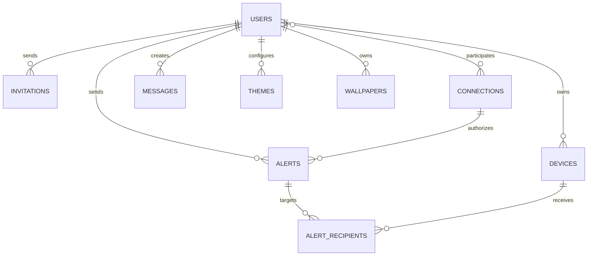

# Modelo de Dados — Proposta Inicial

Este documento descreve entidades conceituais. Os nomes, campos e índices finais serão definidos durante a implementação do Firestore.

## 1. Entidades

### Users
Representa uma conta individual.
- Caminho Firestore: `/users/{uid}`; o UID do Firebase Authentication é o identificador principal.
- `uid` — obrigatório e igual ao ID do documento.
- `name` — nome de exibição informado no cadastro.
- `email` — e-mail da identidade autenticada.
- `createdAt` — timestamp de servidor, preservado nas atualizações.
- `updatedAt` — timestamp de servidor da última criação/atualização.
- Senhas nunca são armazenadas no Firestore; ficam sob gestão do Firebase Authentication.

### Devices
Representa uma instalação/dispositivo associado a uma conta.
- `deviceId` — identificador da instalação.
- `ownerUid` — proprietário.
- `displayName` — nome amigável.
- `platform` — plataforma.
- `fcmToken` — token de notificação, com acesso restrito.
- `lastSeenAt` — último contato.
- `enabled` — indica se o dispositivo está ativo.

### Connections
Representa uma conexão aceita entre duas contas.
- `connectionId`
- `participantUids` — identificadores dos participantes.
- `status` — estado da conexão.
- `createdAt`
- `acceptedAt`
- `endedAt`

### Invitations
Representa um convite enviado.
- `invitationId`
- `senderUid`
- `recipientEmail` ou identificador de convite.
- `codeHash` — hash do código, quando aplicável.
- `status` — pendente, aceito, recusado, expirado ou cancelado.
- `expiresAt`
- `createdAt`

### Alerts
Representa a solicitação de alerta.
- `alertId`
- `senderUid`
- `connectionId`
- `messageId` ou conteúdo validado da mensagem.
- `title` — título opcional do alerta.
- `visual` — composição selecionada (ícone, tipo/cor de fundo, configuração de padrão ou referência da imagem), sujeita a validação antes de transmissão.
- `soundId`
- `createdAt`
- `status`

### AlertRecipients
Representa o estado individual de cada dispositivo destinatário.
- `recipientId`
- `alertId`
- `recipientUid`
- `deviceId`
- `deliveryStatus`
- `processedAt`
- `acknowledgedAt`
- `failureReason`

### Messages
Representa mensagens personalizadas.
- `messageId`
- `ownerUid`
- `title`
- `content`
- `createdAt`
- `updatedAt`

### Themes
Representa preferências visuais.
- `ownerUid`
- `themeMode`
- `colorPalette`
- `customColors`
- `updatedAt`

### Wallpapers
Representa imagens e preferências de fundo.
- `wallpaperId`
- `ownerUid`
- `storagePath` ou referência local/fornecida pelo sistema.
- `source`
- `createdAt`

## 2. Relacionamentos

- Um usuário possui vários dispositivos.
- Um usuário pode participar de várias conexões.
- Uma conexão possui dois participantes no escopo inicial.
- Um usuário pode enviar e receber vários convites.
- Um alerta pertence a um remetente e a uma conexão.
- Um alerta pode possuir vários destinatários/dispositivos.
- Um usuário pode possuir várias mensagens e preferências de personalização.

## 3. Diagrama conceitual

## 4. Regras de integridade

- Um dispositivo pertence a uma única conta ativa.
- Apenas participantes de uma conexão ativa podem trocar alertas por meio dela.
- O backend deve validar a propriedade de cada dispositivo destinatário.
- Cada estado de destinatário deve ser atualizado de maneira idempotente.
- Tokens FCM devem ser protegidos e removidos/atualizados quando inválidos.
- O usuário só pode consultar dados aos quais possui autorização.
- Exclusão de conta deve possuir política documentada para dados relacionados.

## 5. Observações

O schema efetivamente habilitado nesta etapa contém apenas `/users/{uid}`. `firestore.rules` restringe acesso ao próprio documento e não permite campos extras. Dispositivos, convites e conexões continuam sendo modelos futuros, sem dados fictícios.

Este modelo é conceitual e não deve ser tratado como schema definitivo. Antes da implementação, serão definidos caminhos de coleções/documentos, índices compostos, regras de segurança e estratégia de exclusão/retention.

O editor atual mantém um `AlertDraft` local, separado da interface. A URI escolhida pelo Photo Picker é uma referência local do dispositivo e não deve ser enviada ao Firestore como se fosse mídia remota. Um futuro formato persistido/transmitido deverá definir como compartilhar os recursos visuais incluídos no app e como disponibilizar imagens privadas aos destinatários.
