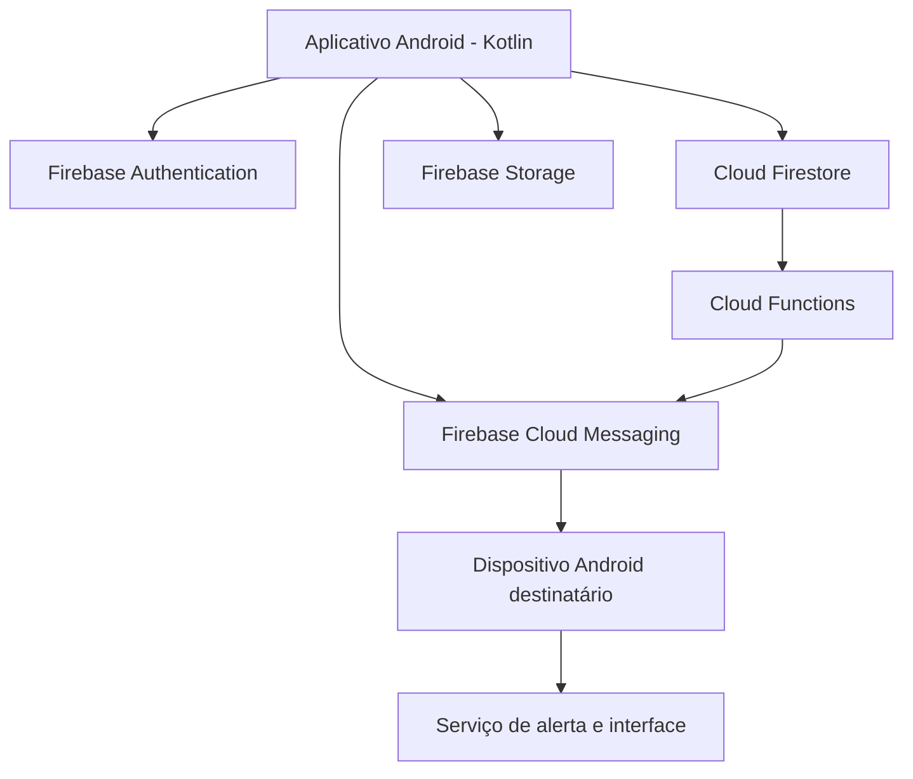

# Arquitetura do Sistema

## 1. Visão geral

WakeMe será inicialmente um aplicativo Android nativo. O cliente se comunica com serviços Firebase, enquanto operações que exigem confiança — como validar conexões e encaminhar alertas — devem ocorrer em ambiente de backend.

## 2. Aplicativo Android

- **Kotlin:** linguagem principal.
- **Jetpack Compose:** interface declarativa.
- **Material 3:** componentes e sistema visual.
- **Navigation Compose:** navegação entre telas.
- **ViewModel e StateFlow:** estado e lógica de apresentação.
- **Coroutines:** operações assíncronas.
- **Android notification APIs:** notificações.
- **Android audio APIs:** reprodução e configuração de áudio permitida.
- **DataStore:** preferências locais, quando apropriado.

A organização interna será definida por funcionalidades e responsabilidades, evitando concentrar toda a lógica em Activities.

## 3. Firebase

### Firebase Authentication
Responsável pela identidade e autenticação das contas individuais.

### Cloud Firestore
Armazenará perfis, dispositivos, conexões, convites, mensagens, alertas e histórico. Regras de segurança devem limitar leituras e escritas aos participantes autorizados.

### Firebase Cloud Messaging
Transportará notificações/comandos para dispositivos registrados. FCM não é garantia de execução imediata nem confirmação de que a pessoa viu o alerta.

### Cloud Functions
Validará solicitações e autorização antes de encaminhar alertas. Segredos e credenciais administrativas permanecem no ambiente de servidor.

### Firebase Storage
Poderá armazenar wallpapers e mídias selecionadas, com regras de acesso e limites de tamanho/tipo.

## 4. Fluxo de alerta

1. O usuário autenticado seleciona uma conexão e dispositivos destinatários.
2. O aplicativo solicita o envio ao backend.
3. O backend verifica identidade, conexão ativa, propriedade dos dispositivos e limites de uso.
4. O backend cria o registro do alerta e seus destinatários.
5. O backend encaminha mensagens FCM aos dispositivos elegíveis.
6. O aplicativo receptor processa a mensagem e apresenta notificação/experiência de alerta conforme as regras do Android.
7. O aplicativo atualiza o estado técnico de processamento.
8. O destinatário pode confirmar explicitamente o alerta.
9. O histórico apresenta os estados individualmente por dispositivo.

## 5. Estados de alerta

Os estados deverão ser definidos com cuidado. Proposta inicial:

- `requested`: solicitação criada.
- `accepted_by_backend`: solicitação validada e aceita pelo backend.
- `sent_to_fcm`: solicitação encaminhada ao FCM.
- `processed_by_device`: aplicativo receptor processou o alerta.
- `acknowledged_by_user`: destinatário confirmou explicitamente.
- `failed`: falha conhecida.
- `cancelled`: cancelado quando ainda possível.

O sucesso de uma chamada FCM não deve ser tratado como prova de que o aparelho tocou ou que a pessoa ouviu.

## 6. Considerações Android

- A reprodução em segundo plano deverá ser implementada com APIs e tipos de serviço apropriados à versão do Android.
- Notificações exigem canais e, em versões recentes, permissão do usuário.
- Alarmes exatos podem exigir permissões e justificativa de uso.
- Alterar volume e atravessar o modo Não Perturbe envolve restrições e permissões específicas.
- A interface não deve presumir que pode aparecer sobre a tela bloqueada sem configuração e consentimento.
- Testes em aparelhos Samsung e Motorola são necessários devido às diferenças de gerenciamento de bateria.

## 7. Segurança

O cliente não deve escolher livremente tokens de outros usuários nem enviar notificações diretamente a qualquer dispositivo. O backend resolve os destinatários a partir de conexões e dispositivos autorizados.

As regras do Firestore e Storage devem ser testadas antes de dados reais. Arquivos de service account e credenciais privadas nunca devem entrar no repositório.

## 8. Observabilidade

Registrar erros técnicos e identificadores de correlação sem expor conteúdo privado, tokens ou credenciais. O histórico visível ao usuário deve distinguir entrega técnica, processamento pelo aplicativo e confirmação explícita.
